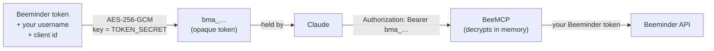

# BeeMCP: Beeminder for Claude

A remote [MCP](https://modelcontextprotocol.io) server for [Beeminder](https://www.beeminder.com).
To connect, paste one URL into Claude and approve on Beeminder. There's no API key to copy and no account to create.

```
https://beemcp.netlify.app/mcp
```

**Tools:** `list_goals` · `get_goal` · `list_datapoints` · `add_datapoint` · `update_datapoint` · `delete_datapoint` · `ratchet_goal` · `refresh_goal` · `get_user`

## Connecting

1. In Claude, go to **Settings → Connectors → Add custom connector** and paste the URL above.
2. BeeMCP shows which app is asking for access. Click **Continue to Beeminder**.
3. Approve on beeminder.com. You're sent back to Claude, connected.

To disconnect, remove the connector in Claude. To cut access everywhere at once, revoke the app in Beeminder's account settings.

## How your data is stored

The short answer: it isn't stored anywhere. BeeMCP has no database.

When you approve, Beeminder gives BeeMCP an access token for your account. BeeMCP encrypts that token and hands the encrypted result to Claude as Claude's own access token. Only BeeMCP can decrypt it, and only for the length of one request.



What's inside the token Claude holds:

```
bma_ + base64url( IV ‖ ciphertext ‖ tag )
                  │    │            └─ 16-byte tag: any change to the token makes decryption fail
                  │    └─ AES-256-GCM encryption of:
                  │         { "bm":  "<your Beeminder access token>",
                  │           "u":   "stolati21",
                  │           "cid": "<which app connected>",
                  │           "typ": "access", "iat": 1763852400, "exp": 1766444400 }
                  └─ 12 random bytes, new for every token
```

- **Without `TOKEN_SECRET` the token is unreadable**, and tampering with it makes decryption fail.
- **Every value in the sign-in flow uses the same format**, with a different prefix and lifetime:

  | Prefix | What it is | Lifetime |
  |---|---|---|
  | `bmc_` | registered app (client id) | none |
  | `bmp_` | sign-in in progress | 10 min |
  | `bmo_` | one-time authorization code | 2 min |
  | `bma_` | access token | 30 days |
  | `bmr_` | refresh token | until Beeminder access is revoked |

- **Revoking** the app in Beeminder kills the Beeminder token inside every copy, so they all stop working.
- **Rotating `TOKEN_SECRET`** makes every existing token unreadable, which signs everyone out.

## What gets logged

- **To you, in Claude:** every tool result includes a short `activity` list of what happened. These lines are part of the answer Claude already receives; nothing extra is sent anywhere. For example:
  `Adding 5 to "run"` → `Beeminder POST …/datapoints.json → 200 (180 ms)` → `Done`
- **To the host (Netlify function log):** one line per sign-in step, such as `consent_shown`, `token_issued` or `token_failed: pkce_mismatch`, so you can debug a failed connection.

Neither one ever contains a token, code or secret. As a safety net, everything logged also passes through a filter that masks anything token-shaped. `npm test` checks every response and every log line for each secret.

## Security

- **BeeMCP's own approval page runs before Beeminder's.** Any app can register with BeeMCP, and Beeminder may skip its approval screen for someone who approved before. Without this page, another app could quietly get a user's access. The page can't be embedded in another site, and its approve button only works from the page itself (CSRF protection). The button locks after the first click.
- **PKCE (S256) is required**, so an intercepted sign-in code is useless on its own.
- **Rate limits** are 60 requests/min for sign-in and 300 requests/min for MCP, per IP.

## Deploy your own (Netlify)

The full walkthrough, with every value and a troubleshooting list, is at <https://beemcp.netlify.app/self-host>.

1. Register an app at <https://www.beeminder.com/apps/new>:
   - Redirect URL: `https://YOUR_SITE/oauth/callback`
   - Post de-authorization callback: `https://YOUR_SITE/oauth/deauthorize`
   - Autofetch callback: leave empty
2. Import this repo into Netlify. The build settings come from `netlify.toml`.
3. Set environment variables:

   | Variable | Value |
   |---|---|
   | `BEEMINDER_CLIENT_ID` | the app's **ID** (not the secret; BeeMCP doesn't use the secret) |
   | `TOKEN_SECRET` | a long random string, e.g. `openssl rand -hex 32` |
   | `PUBLIC_BASE_URL` | optional; pins the public URL if the site has several hostnames |

4. Redeploy so the variables take effect, then connect with `https://YOUR_SITE/mcp`.

Beeminder allows one redirect URL per app, so sign-in only works on the site that URL points to, not on deploy previews.

## Develop

```bash
npm install
npm run typecheck
npm test            # full sign-in + tool calls against a fake Beeminder
npx netlify dev     # http://localhost:8888
```

## Limitations

- Without a database, an authorization code can't be strictly single-use. It expires after 2 minutes and needs the PKCE verifier, which covers the practical risk.
- Each connection can access the whole Beeminder account. Beeminder's sign-in has no per-goal permissions.

Not affiliated with Beeminder.
